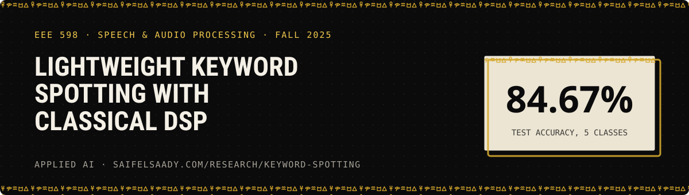
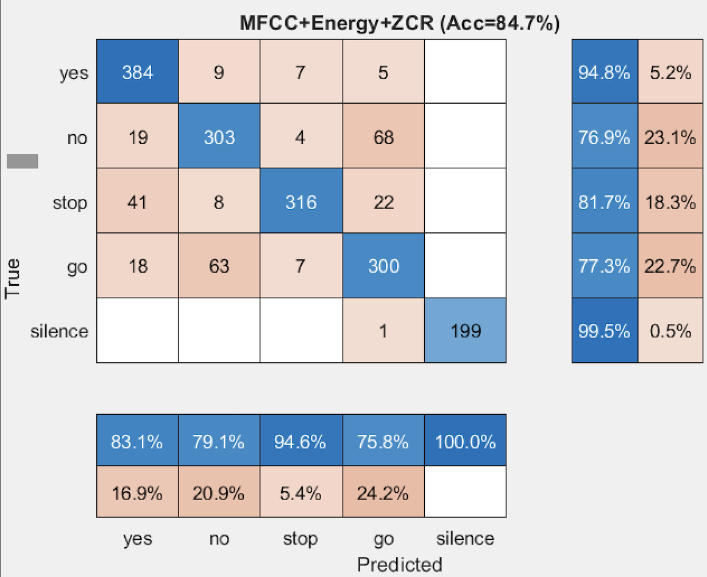
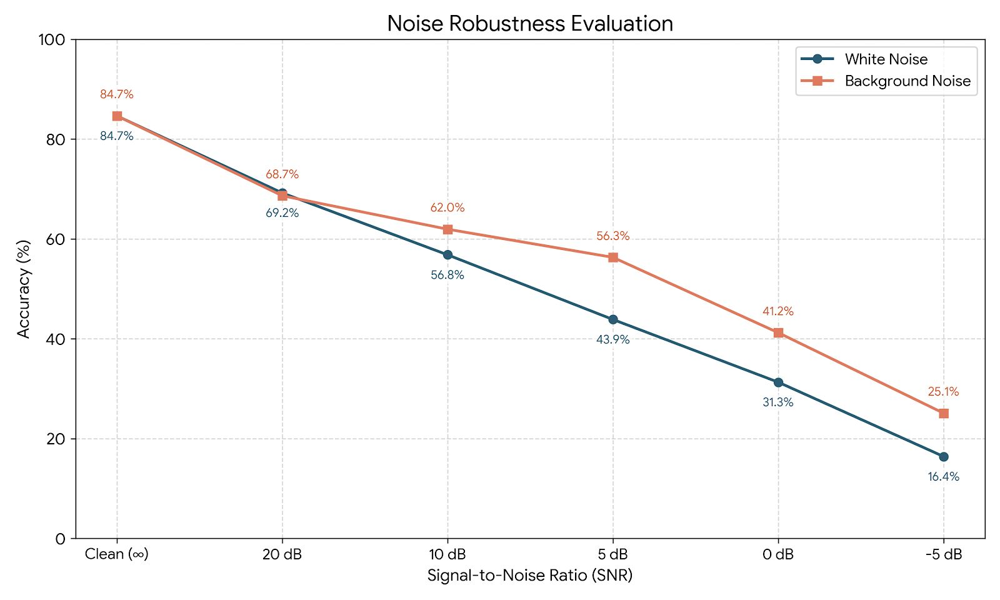
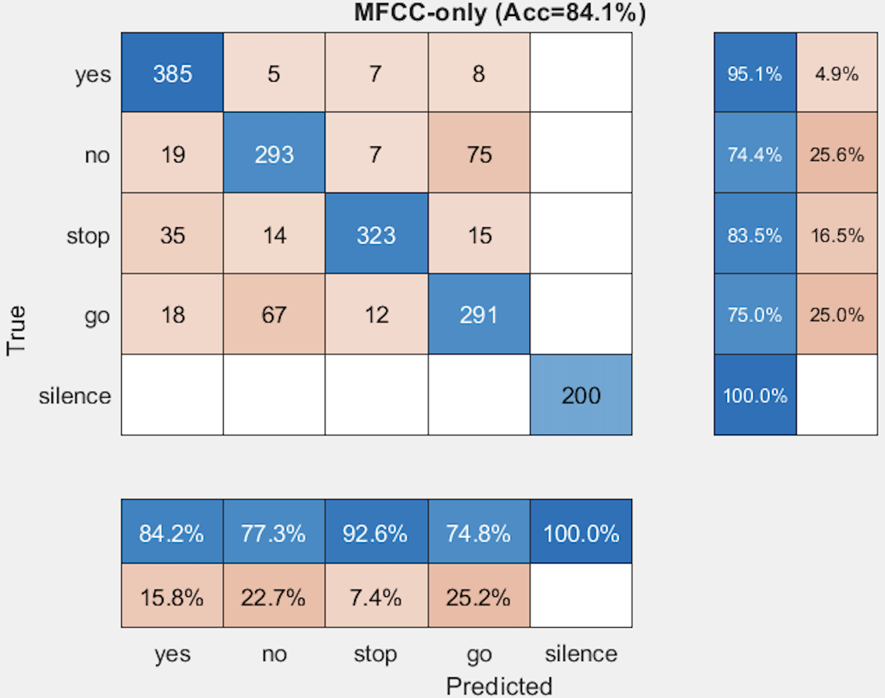
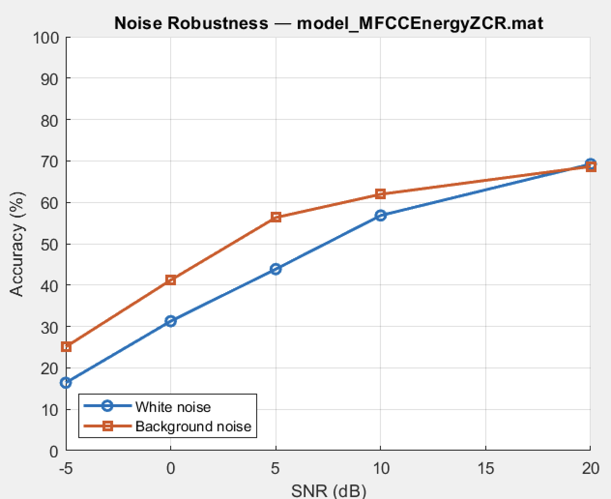

# Lightweight Keyword Spotting with Classical DSP

> Can a 30-number fingerprint and a support vector machine hear “yes”, “no”, “stop” and “go”? Mostly, and it shows exactly where it gets confused.

**EEE 598 · Speech & Audio Processing · Fall 2025** · Built with a project partner · Applied AI

| **84.67%** | **30** | **99.5%** | **>50%** |
|:-:|:-:|:-:|:-:|
| test accuracy, 5 classes | features per clip | silence recall | accuracy down to 10 dB SNR |

**Full case study:** [saifelsaady.com/research/keyword-spotting](https://saifelsaady.com/research/keyword-spotting) · **Project page:** [selsaady1.github.io/eee598-speech-audio-ml](https://selsaady1.github.io/eee598-speech-audio-ml/)

## The question

Keyword spotting is the always-on wake-word problem: a small device has to pick a few command words out of everything else it hears, on a tight compute budget. Deep networks win the benchmarks but cost memory and power. This project asked how far classical signal processing and a kernel classifier can go, small enough for embedded or system-on-chip use.

## How it works

1. **Data.** Google Speech Commands v2, five classes: yes, no, stop, go and silence. Clips resampled to 16 kHz, trimmed, normalized and fixed to one second.
2. **Features.** 20–25 ms Hamming windows with a 10 ms hop. Short-time energy, zero-crossing rate and 13 MFCCs, each summarized by its mean and standard deviation: a 30-dimensional vector per clip.
3. **Models.** k-NN (k = 1, 3, 5, 7) against an RBF-kernel SVM with a grid search over kernel scale and the box constraint C, tuned on a validation split and scored once on a held-out test set.
4. **Stress test.** White noise and real background noise mixed in at 20, 10, 5, 0 and −5 dB signal-to-noise ratio.

## What it found

- The SVM on MFCC + energy + ZCR reached 84.67% test accuracy, clearing the project's 75% target.
- Silence is almost never missed (99.5% recall). The main confusion is “no” versus “go”: 68 “no” clips were heard as “go” and 63 the other way round.
- Accuracy degrades gracefully: about 69% at 20 dB and still above 50% at 10 dB for both noise types. Real background noise hurt less than white noise at low SNR.

## Figures

_Test-set confusion matrix for MFCC + energy + ZCR (84.7%). The only big off-diagonal cells are no ↔ go._

_Accuracy as noise rises, from clean audio down to −5 dB SNR._

_MFCC features alone reach 84.1%; adding energy and zero-crossing rate lifts it to 84.7%._

_The same noise sweep, run from the MATLAB implementation._

## Takeaway

> Hand-crafted features plus a well-tuned kernel get most of the way for a small vocabulary, and the remaining errors are acoustically honest ones.

## In this repository

| Path | What it is |
|---|---|
| [`docs/EEE 598 - Final Project Report-2.docx.pdf`](docs/EEE%20598%20-%20Final%20Project%20Report-2.docx.pdf) | Final report (PDF) |
| [`docs/Lightweight Keyword Spotting Using Energy and MFCC Features for Embedded Deployment (1).pdf`](docs/Lightweight%20Keyword%20Spotting%20Using%20Energy%20and%20MFCC%20Features%20for%20Embedded%20Deployment%20(1).pdf) | Paper-style write-up (PDF) |
| [`docs/EEE598_Final_Project_Proposal.pdf`](docs/EEE598_Final_Project_Proposal.pdf) | Project proposal (PDF) |
| [`docs/Kws Project Plan (1).pdf`](docs/Kws%20Project%20Plan%20(1).pdf) | Four-phase project plan (PDF) |
| [`docs/FinalProject.docx`](docs/FinalProject.docx) | Report source (Word) |
| [`src/Phase1_Preprocessing_Script.py`](src/Phase1_Preprocessing_Script.py) | Python phase 1: resample, trim, normalize, split 70/15/15 |
| [`src/Phase2_Feature_Extraction.py`](src/Phase2_Feature_Extraction.py) | Python phase 2: energy, ZCR and MFCC features |
| [`src/Phase3_Classifier_Training.py`](src/Phase3_Classifier_Training.py) | Python phase 3: k-NN and SVM training and tuning |
| [`src/Phase4_Testing_Final_Evaluation.py`](src/Phase4_Testing_Final_Evaluation.py) | Python phase 4: test-set and noise evaluation |
| [`src/EEE598_Final_Project.m`](src/EEE598_Final_Project.m) | MATLAB implementation of the full system |
| [`src/`](src/) | Also: course DSP demos in MATLAB (autocorrelation, filtering, spectrograms, quantization, cepstrum, source-filter) |

## Run it

- The Python pipeline lives in `src/` as four phases. It needs the Google Speech Commands v2 dataset downloaded locally.
- Point `PROJECT_DATA_DIR` (phase 1) and `PROJECT_IMPLEMENTATION_DIR` (every phase) at your own folders, then run phases 1 to 4 in order (`python src/Phase1_Preprocessing_Script.py`, and so on).
- Dependencies: `numpy scipy pandas librosa soundfile scikit-learn matplotlib seaborn tqdm`.

## Tools

MATLAB · Python · librosa · scikit-learn · NumPy · SVM · k-NN · MFCC / STFT

## License

MIT, see [`LICENSE`](LICENSE).

---
_Part of [Saif Elsaady's portfolio](https://saifelsaady.com/projects). Deliverables only; routine homework, quizzes and exams are excluded._
